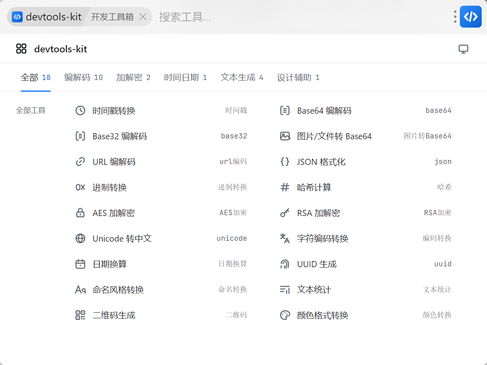
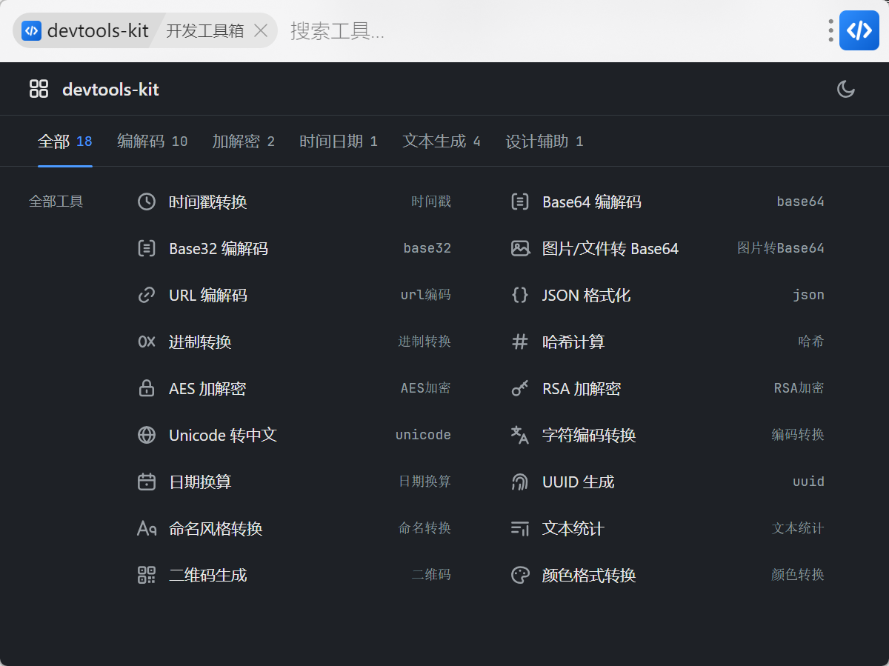

# DevTools Kit · uTools 开发工具箱

[](https://github.com/HelloThreeLiu/devtools-kit/actions/workflows/ci.yml)
[](LICENSE)

> 面向开发者的 uTools 一站式开发工具箱：时间戳转换、日期换算（农历/日期差）、Base64、JSON 格式化等高频小工具。**全部本地计算，数据不出本机。**

## 预览

<p align="center">
  
  
</p>
<p align="center"><sub>暗色模式（跟随系统 / 手动切换） · 亮色模式 · 主界面按分类页签组织 18 个工具（编解码 / 加解密 / 时间日期 / 文本生成 / 设计辅助）</sub></p>

## 特性

- 🧰 **18 个高频开发工具**，五大分类（编解码 / 加解密 / 时间日期 / 文本生成 / 设计辅助），开箱即用
- ⚡ **输入即转换 + 一键复制**，键盘优先；支持 uTools 搜索直达与智能匹配（粘贴时间戳 / URL / JSON / UUID / 颜色值自动进入对应工具）
- 🔐 **加解密**：AES-CBC/GCM 对称加密、RSA 密钥对与签名验签，纯本机运算，密钥不落盘
- 🖥️ 支持 **Windows / macOS / Linux**（跟随 uTools Runtime，CI 在三平台矩阵构建）
- 🌗 **暗色模式**：跟随系统 / 亮色 / 暗色三种模式切换
- 🕘 **历史记录仅存本机**（uTools db），Ctrl+Enter 统一送入主结果，可随时清空，无任何网络请求与遥测

## 工具一览

| 工具 | 分类 | 说明 | 搜索直达 / 智能匹配 |
| --- | --- | --- | --- |
| 时间戳转换 | 编解码 | 秒 / 毫秒时间戳与日期时间双向转换 | `时间戳` `timestamp`；粘贴 8–13 位数字自动进入 |
| Base64 编解码 | 编解码 | 文本与 Base64 双向转换，自动识别方向，支持 Base64URL 输出与空白容错 | `base64` |
| Base32 编解码 | 编解码 | RFC 4648 Base32 编解码，UTF-8 安全，padding 容错 | `base32` |
| 图片/文件转 Base64 | 编解码 | 图片与任意文件 ↔ Base64 / Data URL，魔数识别格式，图片预览、复制图片与另存为 | `图片转Base64` `文件转Base64` |
| URL 编解码 | 编解码 | URL 编解码（智能模式：完整 URL 保留结构）与查询参数结构化解析，宽容解码 | `url编码`；粘贴 URL 自动进入 |
| JSON 格式化 | 编解码 | 格式化、压缩、校验并定位语法错误 | `json`；粘贴 JSON 自动进入 |
| 进制转换 | 编解码 | 2 / 8 / 10 / 16 进制互转，大数安全 | `进制转换` `hex转十进制` |
| 哈希计算 | 编解码 | MD5 / SHA-1 / SHA-256 / SHA-512 | `哈希` `md5` `sha` |
| AES 加解密 | 加解密 | AES-CBC / GCM 对称加解密，密钥一键生成（128/192/256 位） | `AES加密` `AES解密` `AES` |
| RSA 加解密 | 加解密 | RSA 密钥对、加密解密（OAEP / PKCS#1）与签名验签 | `RSA加密` `RSA解密` `RSA` |
| Unicode 转中文 | 编解码 | `\uXXXX` 转义与中文互转 | `unicode` |
| 字符编码转换 | 编解码 | GBK / UTF-8 / UTF-16 字节与文本互转（Hex / Base64），乱码复原 | `编码转换` `GBK` `乱码` |
| 日期换算 | 时间日期 | 农历、星期、年内序数与日期差 | `农历` `日期换算` |
| UUID 生成 | 文本生成 | UUID v4 批量生成，多种格式 | `uuid` `guid`；粘贴 UUID 自动校验 |
| 命名风格转换 | 文本生成 | camel / snake / kebab 等五种命名互转 | `命名转换` `驼峰转换` |
| 文本统计 | 文本生成 | 字数、行数、UTF-8 字节数统计 | `文本统计` `字数统计` |
| 二维码生成 | 文本生成 | 文本转二维码，本地生成可复制 | `二维码` `qrcode` |
| 颜色格式转换 | 设计辅助 | HEX / RGB / HSL 互转与预览 | `颜色转换` `取色`；粘贴颜色值自动进入 |

> 完整需求与迭代规划见 [docs/PRD.md](docs/PRD.md)。

## 使用

1. 安装 [uTools](https://u.tools/) 及其插件市场中的「uTools 开发者工具」；
2. 克隆本仓库后，在开发者工具中「新建项目」指向仓库根目录（开发模式，`plugin.json` 的 `development.main` 已指向 `http://localhost:5173`，需先 `npm run dev`）；
3. 或使用 `npm run build` 产物 `dist/`（即 uTools 插件应用目录）打包安装。

在 uTools 中输入关键词直达工具，或直接粘贴时间戳 / URL / JSON / UUID / 颜色值触发智能匹配。

## 开发

环境要求：Node.js ≥ 18；技术栈：Vue 3（Composition API）+ Vite + Vitest，无 UI 组件库依赖，样式基于[设计令牌](docs/设计令牌.md)。

```bash
npm install
npm run dev     # Vite 开发服务器，浏览器直接调试 UI（无需 uTools）
npm run build   # 生产构建 → dist/（即 uTools 插件应用目录）
npm test        # Vitest 纯函数单测
npm run audit   # 静态审计：导入完整性 / payload hooks / CSS 类 / match 正则
npm run check   # plugin.json 合规校验 + audit + 构建 + dist 插件结构校验
```

### 目录结构

```
├── public/plugin.json     # uTools 插件描述（features 即搜索直达入口）
├── src/
│   ├── tools/index.js     # 工具注册表 —— 新增工具的唯一扩展点
│   ├── tools/<id>/        # 各工具页面组件（Vue SFC）
│   ├── utils/convert/     # 纯函数层（与 UI 解耦，可单测）
│   └── utils/             # utools 适配 / 主题 / 剪贴板 / 历史记录等
├── tests/                 # Vitest 单测（对应 utils/convert 纯函数）
├── scripts/               # 校验脚本（plugin.json / dist / 静态审计）
└── docs/                  # PRD / 技术设计 / 设计令牌 / 测试清单等
```

### 新增一个工具

1. 在 `src/tools/index.js` 注册（`id` / `code` / `name` / `cmds` / `category` / `component` 等）；
2. 实现 `src/tools/<id>/index.vue` 页面组件；
3. 纯计算逻辑放入 `src/utils/convert/<id>.js`，并在 `tests/<id>.spec.js` 补充单测；
4. 在 `public/plugin.json` 增加对应 `feature`（搜索直达入口）；
5. UI 严格遵循 [docs/设计令牌.md](docs/设计令牌.md)（CSS 类有静态检查）。

## 贡献

欢迎提交 Issue 与 Pull Request！提交前请阅读以下要求。

### 贡献流程

1. Fork 仓库或从 `main` 拉取功能分支，命名建议 `feat/xxx`、`fix/xxx`、`docs/xxx`；
2. 开发并补充/更新对应单测；
3. 本地自检全部通过（见下方清单）；
4. 提交 PR 到 `main`，描述清楚改动动机、方案与验证方式，关联对应 Issue。

### 提交信息

遵循 [Conventional Commits](https://www.conventionalcommits.org/zh-hans/)，描述用中文，可带作用域：

```
feat(tools): 新增 xx 工具
fix(json): 修复折叠超长内容崩溃白屏
docs: 更新 README
chore(ci): 调整静态检查
```

### 代码要求

- **纯函数与组件分离**：业务计算写在 `src/utils/convert/`，不依赖 DOM 与 uTools API，确保可单测；新增/变更逻辑必须有对应 `tests/*.spec.js`；
- **UI 遵循设计令牌**：所有 UI 改动必须使用 [docs/设计令牌.md](docs/设计令牌.md) 定义的令牌与 CSS 类，禁止硬编码颜色/间距（CI 有 CSS 类静态检查）；
- **注册表与 plugin.json 同步**：工具注册、`cmds` 关键词与 `features` 声明需保持一致（`validate-plugin.mjs` 会校验）；
- **保持本地计算承诺**：不得引入网络请求、遥测或统计；数据仅通过 uTools db 存本机；
- **谨慎新增依赖**：当前运行时依赖仅 `vue` 与 `qrcode`，新增运行时依赖需在 PR 中说明必要性。

### PR 自检清单

- [ ] `npm run check` 通过（plugin.json 校验 + 静态审计 + 构建 + dist 结构校验）
- [ ] `npm test` 通过，新增/变更逻辑有对应单测
- [ ] UI 改动符合设计令牌规范
- [ ] 涉及 uTools 真机行为（匹配指令、剪贴板、db）的改动已按 [docs/测试清单.md](docs/测试清单.md) 走查
- [ ] 提交信息符合 Conventional Commits

CI 会在 **Windows / Linux / macOS** 三平台矩阵执行上述校验，PR 需三平台全绿方可合并。

### Issue 规范

- **Bug**：附复现步骤、期望结果、实际结果，以及操作系统与 uTools 版本；
- **新工具需求**：说明使用场景、输入输出示例与优先级建议（参考 [docs/PRD.md](docs/PRD.md) 的优先级定义）。

## 文档

| 文档 | 说明 |
| --- | --- |
| [docs/PRD.md](docs/PRD.md) | 产品需求文档（含验收标准与迭代规划） |
| [docs/迭代计划.md](docs/迭代计划.md) | 迭代计划与排期（v1.1–v1.3，含周排期与需求状态跟踪） |
| [docs/用户反馈分析.md](docs/用户反馈分析.md) | 用户反馈归类分析（下一期功能规划输入） |
| [CHANGELOG.md](CHANGELOG.md) | 版本发布日志（v1.1.0 起，所有功能变更逐版本记录） |
| [docs/技术设计.md](docs/技术设计.md) | 技术方案（架构 / 路由 / 数据层 / 实现要点） |
| [docs/设计令牌.md](docs/设计令牌.md) | UI 设计令牌规范（**所有 UI 改动必须遵循**） |
| [docs/代码审查报告.md](docs/代码审查报告.md) | 全量代码审查报告（2026-11-26，含 PRD 对照矩阵） |
| [docs/修复记录.md](docs/修复记录.md) | 审查问题修复记录（含验证结果与文件清单） |
| [docs/测试清单.md](docs/测试清单.md) | M5 测试走查清单（uTools 真机逐条走查） |
| [docs/prototype/index.html](docs/prototype/index.html) | 高保真可交互原型（浏览器直接打开审阅） |

## 许可证

[MIT](LICENSE)
